# Report 4 - Phân tích dữ liệu qua trực quan hóa (tạo bởi `python -m report4.visualize`)

Dữ liệu: `report3_prepared.csv` (3.507 dòng, đã xử lý ở Report 3) và `matched_products.csv` (139 cặp cùng sản phẩm).
Cách chọn biểu đồ theo slide 6.3: so sánh nhóm -> bar/column; phân phối -> histogram; quan hệ 2 biến liên tục -> scatter; cơ cấu -> pie / stacked column; theo thời gian -> line; slide 6.4: histogram theo nhóm, box plot.

| # | Biểu đồ | Loại | Theo slide |
|---|---|---|---|
| 1 | Số sản phẩm theo nhóm hàng và siêu thị | Column chart nhóm (grouped column) | 6.3 - so sánh các nhóm (ít category) dùng bar/column chart |
| 2 | Giá trung vị theo nhóm hàng và siêu thị | Bar chart ngang nhóm | 6.3 bar chart + 6.4 so sánh 1 số đo theo 2 biến phân loại |
| 3 | Tỉ lệ khuyến mãi theo nhóm hàng | Column chart nhóm | 6.3 - so sánh các nhóm |
| 4 | Cơ cấu phân khúc giá (binning) trong từng nhóm hàng | Stacked column 100% | 6.3 - thể hiện cơ cấu (composition) bằng stacked column; binning slide 2.6 |
| 5 | Cơ cấu nhóm hàng của mỗi siêu thị | Pie chart (2 bánh) | 6.3 - cơ cấu dữ liệu tĩnh (static composition) dùng pie chart |
| 6 | Phân phối giá bán (histogram) | Histogram (dạng đường bậc thang, 2 siêu thị chồng nhau) | 6.3 - thể hiện phân phối dùng histogram; 6.4 histogram theo nhóm |
| 7 | Boxplot giá theo nhóm hàng và siêu thị | Box plot | 6.4 - box plots (so sánh phân bố giữa các nhóm) |
| 8 | Boxplot giá trên kg/lít | Box plot | 6.4 - box plots |
| 9 | Scatter: khối lượng gói và giá | Scatter plot | 6.3 - quan hệ giữa 2 biến liên tục dùng scatter plot |
| 10 | Scatter: giá BHX và WinMart của 139 cặp cùng sản phẩm | Scatter plot + đường y = x | 6.3 - scatter plot |
| 11 | Histogram chênh lệch giá 139 cặp | Histogram | 6.3 - phân phối |
| 12 | Chênh lệch trung vị theo nhóm hàng (139 cặp) | Bar chart ngang (2 phía quanh 0) | 6.3 - so sánh các nhóm |

## Hình 1. Số sản phẩm theo nhóm hàng và siêu thị

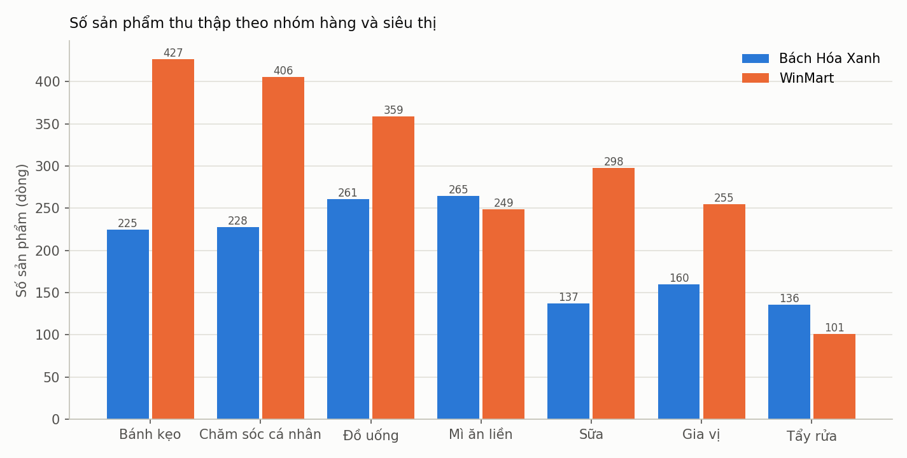

- **Loại biểu đồ:** Column chart nhóm (grouped column) (slide 6.3 - so sánh các nhóm (ít category) dùng bar/column chart)
- **Vì sao chọn:** 7 nhóm hàng x 2 siêu thị là biến phân loại -> so sánh số lượng bằng cột đặt cạnh nhau.
- **Nhận xét:**
  - WinMart có 2.095 sản phẩm, BHX 1.412.
  - Chênh lệch lớn nhất ở nhóm Bánh kẹo: WinMart 427 vs BHX 225.
  - Nhóm BHX có nhiều sản phẩm hơn: Mì ăn liền, Tẩy rửa.
  - => Hai kệ hàng có cơ cấu khác nhau: không thể so giá trung bình cả kệ mà kết luận nơi nào rẻ hơn.

## Hình 2. Giá trung vị theo nhóm hàng và siêu thị

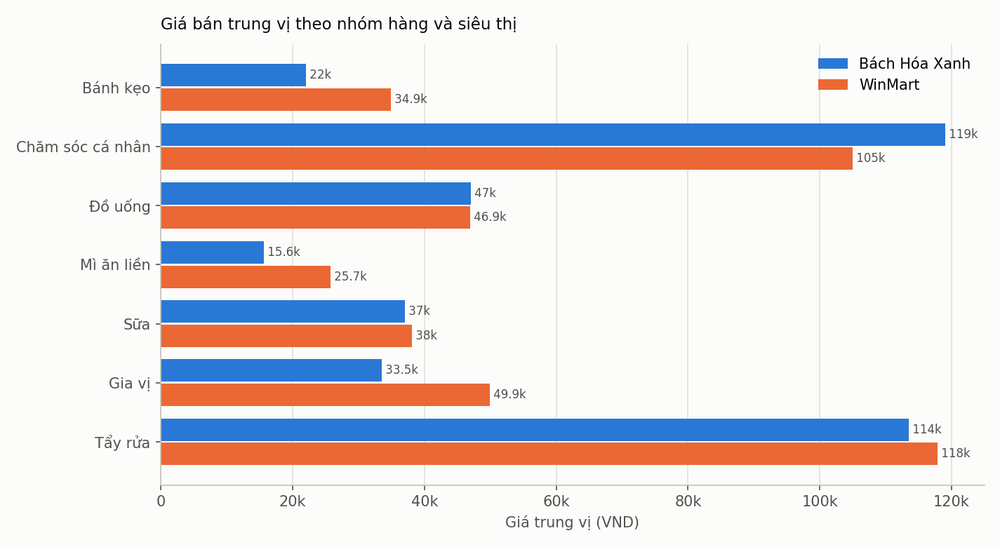

- **Loại biểu đồ:** Bar chart ngang nhóm (slide 6.3 bar chart + 6.4 so sánh 1 số đo theo 2 biến phân loại)
- **Vì sao chọn:** Giá lệch phải mạnh nên dùng TRUNG VỊ (slide 6.2) thay cho trung bình; 2 biến phân loại (nhóm, siêu thị).
- **Nhận xét:**
  - Trung vị WinMart cao hơn ở 5/7 nhóm: Bánh kẹo, Mì ăn liền, Sữa, Gia vị, Tẩy rửa.
  - Nhóm đắt nhất: Chăm sóc cá nhân (~119k); rẻ nhất: Mì ăn liền (~15,6k).
  - => Chênh lệch trung vị phản ánh khác MẶT HÀNG (gói lẻ, thùng); hình 10-12 so CÙNG sản phẩm.

## Hình 3. Tỉ lệ khuyến mãi theo nhóm hàng

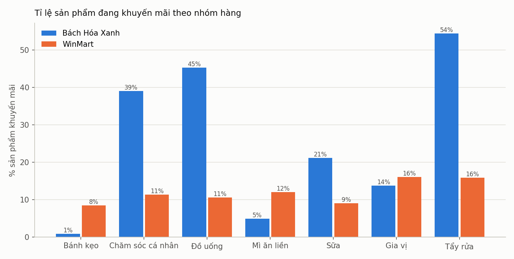

- **Loại biểu đồ:** Column chart nhóm (slide 6.3 - so sánh các nhóm)
- **Vì sao chọn:** So sánh một tỉ lệ (%) giữa 7 nhóm x 2 siêu thị.
- **Nhận xét:**
  - Toàn bộ: BHX 24,6% vs WinMart 11,2% (Chi-square p = 1,2e-25 - có ý nghĩa thống kê, Report 3).
  - BHX khuyến mãi nhiều hơn ở 4/7 nhóm; cao nhất Tẩy rửa 54%.

## Hình 4. Cơ cấu phân khúc giá (binning) trong từng nhóm hàng

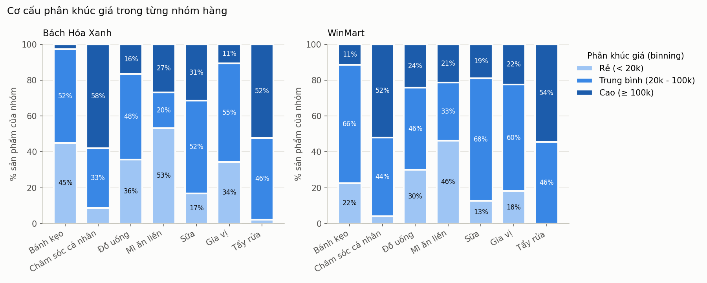

- **Loại biểu đồ:** Stacked column 100% (slide 6.3 - thể hiện cơ cấu (composition) bằng stacked column; binning slide 2.6)
- **Vì sao chọn:** Giá đã chia thành 3 khoảng (binning -> biến ordinal); stacked 100% cho thấy cơ cấu từng nhóm.
- **Nhận xét:**
  - BHX: rẻ 31% - trung bình 42% - cao 27%; WinMart: 20% - 53% - 27%.
  - BHX có tỉ lệ hàng rẻ (< 20k) cao hơn - phù hợp việc BHX bán nhiều gói lẻ, trung vị BHX thấp hơn.

## Hình 5. Cơ cấu nhóm hàng của mỗi siêu thị

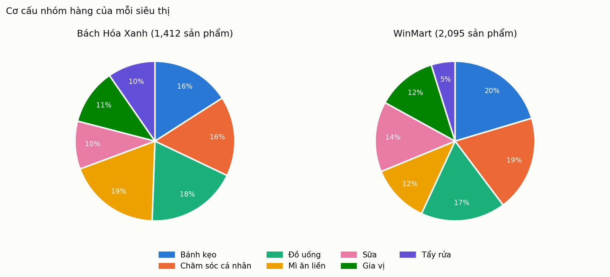

- **Loại biểu đồ:** Pie chart (2 bánh) (slide 6.3 - cơ cấu dữ liệu tĩnh (static composition) dùng pie chart)
- **Vì sao chọn:** Dữ liệu là 1 lần chụp (tĩnh); mỗi bánh = 100% sản phẩm của 1 siêu thị.
- **Nhận xét:**
  - BHX nhiều nhất Mì ăn liền (19%); WinMart nhiều nhất Bánh kẹo (20%).
  - Tẩy rửa chiếm 10% ở BHX nhưng chỉ 5% ở WinMart -> cơ cấu 2 kệ hàng khác nhau.

## Hình 6. Phân phối giá bán (histogram)

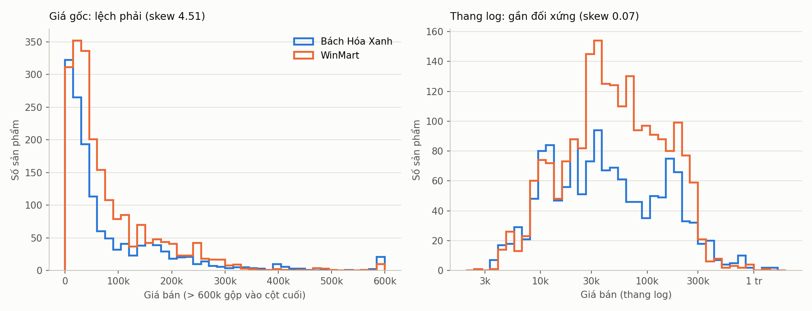

- **Loại biểu đồ:** Histogram (dạng đường bậc thang, 2 siêu thị chồng nhau) (slide 6.3 - thể hiện phân phối dùng histogram; 6.4 histogram theo nhóm)
- **Vì sao chọn:** Giá là biến liên tục (ratio) -> histogram cho thấy hình dạng phân phối.
- **Nhận xét:**
  - Giá lệch phải mạnh: mean 84,9k > median 43,5k > mode 12k.
  - Trên thang log phân phối gần đối xứng, gần chuẩn -> lý do Report 3 dùng log giá cho kiểm định và chuẩn hóa.
  - Histogram WinMart dồn ở khoảng 20k-100k; BHX trải rộng hơn (nhiều gói rẻ và nhiều thùng đắt).

## Hình 7. Boxplot giá theo nhóm hàng và siêu thị

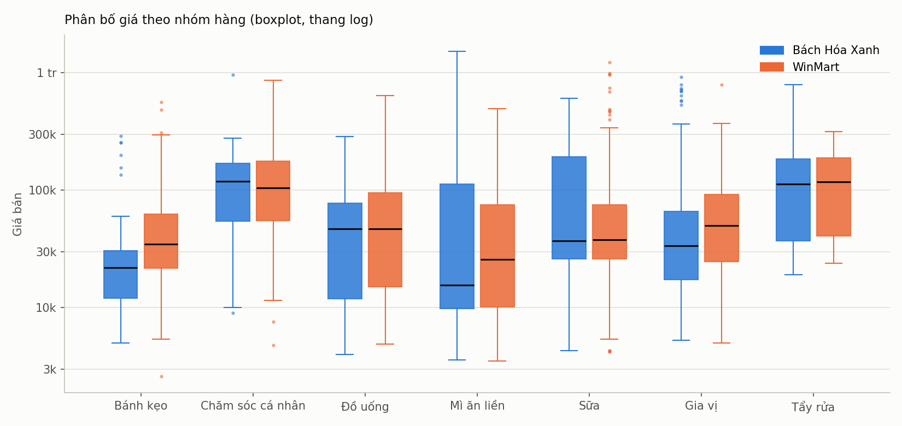

- **Loại biểu đồ:** Box plot (slide 6.4 - box plots (so sánh phân bố giữa các nhóm))
- **Vì sao chọn:** Boxplot cho cùng lúc median, Q1-Q3 (hộp), râu 1,5 x IQR và điểm ngoại lai - đúng quy tắc outlier của Report 3.
- **Nhận xét:**
  - Nhóm phân tán nhất (IQR log lớn nhất): Mì ăn liền; ít phân tán nhất: Bánh kẹo.
  - Có 41 điểm ngoài râu, cả hàng rất rẻ (kẹo vài nghìn đồng) lẫn rất đắt (thùng, sữa bột) - đều là giá thật nên Report 3 chỉ đánh dấu, không xóa.
  - Hộp của 2 siêu thị chồng lên nhau ở hầu hết nhóm -> khoảng giá phổ biến tương đương nhau.

## Hình 8. Boxplot giá trên kg/lít

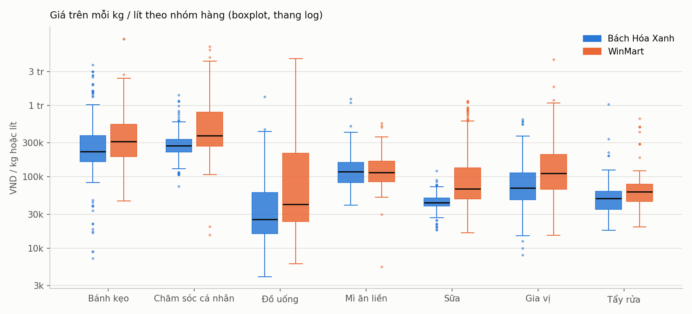

- **Loại biểu đồ:** Box plot (slide 6.4 - box plots)
- **Vì sao chọn:** Giá/kg-lít loại bỏ khác biệt khối lượng gói -> so sánh công bằng hơn giá bán; chỉ dùng 3,159 dòng có khối lượng thật (Report 3 không bịa khối lượng).
- **Nhận xét:**
  - Đắt nhất trên kg/lít: Chăm sóc cá nhân (trung vị ~378k/kg); rẻ nhất: Đồ uống (~25,2k/kg-lít).
  - Trung vị giá/kg-lít WinMart cao hơn BHX ở 6/7 nhóm - một phần do BHX bán nhiều thùng/lốc (mua nhiều rẻ hơn trên mỗi kg).

## Hình 9. Scatter: khối lượng gói và giá

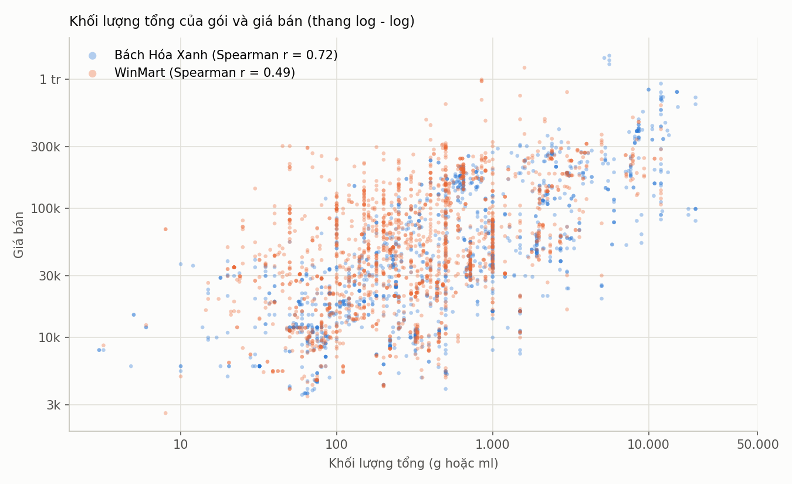

- **Loại biểu đồ:** Scatter plot (slide 6.3 - quan hệ giữa 2 biến liên tục dùng scatter plot)
- **Vì sao chọn:** Khối lượng và giá đều là biến liên tục; thang log vì cả 2 đều lệch phải.
- **Nhận xét:**
  - Quan hệ đồng biến: gói càng lớn càng đắt - Spearman r = 0,72 (BHX, mạnh), 0,49 (WinMart, trung bình).
  - Nhưng khối lượng và giá trên kg có r = -0,63 (âm): mua gói lớn rẻ hơn trên mỗi kg.
  - Tương quan không phải nhân quả (slide 2.7).

## Hình 10. Scatter: giá BHX và WinMart của 139 cặp cùng sản phẩm

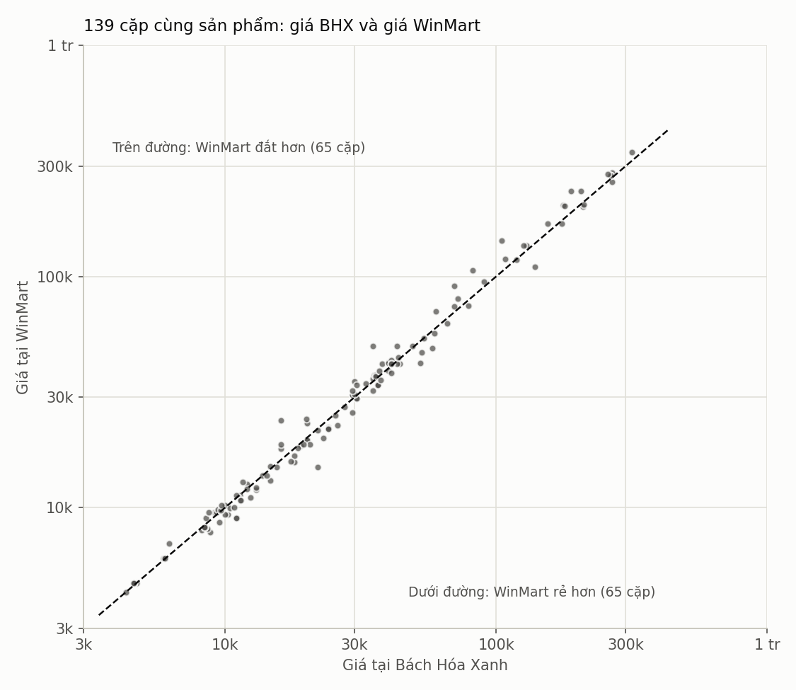

- **Loại biểu đồ:** Scatter plot + đường y = x (slide 6.3 - scatter plot)
- **Vì sao chọn:** Mỗi điểm là 1 sản phẩm có ở cả 2 nơi; điểm nằm trên đường chéo = bằng giá.
- **Nhận xét:**
  - Các điểm bám sát đường chéo (Pearson r = 0,994): cùng sản phẩm thì giá 2 nơi rất gần nhau.
  - 65 cặp trên đường, 65 cặp dưới đường, 9 cặp nằm trên đường.
  - => Không siêu thị nào rẻ hơn một cách có hệ thống (paired t-test p = 0,51, Report 3).

## Hình 11. Histogram chênh lệch giá 139 cặp

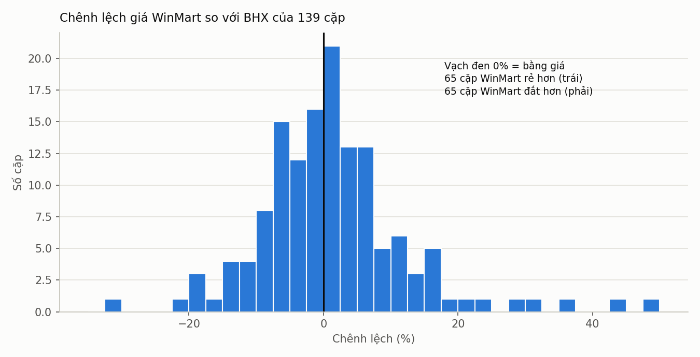

- **Loại biểu đồ:** Histogram (slide 6.3 - phân phối)
- **Vì sao chọn:** Chênh lệch % là biến liên tục; histogram cho thấy nó dồn quanh 0 hay lệch về 1 phía.
- **Nhận xét:**
  - Trung vị chênh lệch 0,0%, trung bình +1,20%.
  - 74% số cặp chênh trong khoảng ±10%; hai bên vạch 0 gần như cân bằng.

## Hình 12. Chênh lệch trung vị theo nhóm hàng (139 cặp)

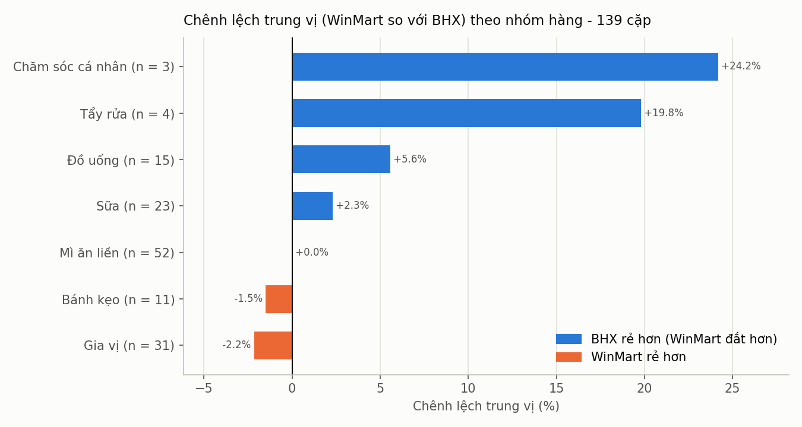

- **Loại biểu đồ:** Bar chart ngang (2 phía quanh 0) (slide 6.3 - so sánh các nhóm)
- **Vì sao chọn:** So sánh 1 số đo (chênh lệch %) giữa 7 nhóm; màu theo siêu thị rẻ hơn.
- **Nhận xét:**
  - WinMart rẻ hơn rõ ở Gia vị (-2,2%); đắt hơn rõ ở Chăm sóc cá nhân (+24,2%).
  - Không nhóm nào có ý nghĩa thống kê (sign test p nhỏ nhất = 0,20); nhóm Chăm sóc cá nhân, Tẩy rửa chỉ 3-4 cặp -> cần thêm dữ liệu.

## Line chart (biểu đồ đường) - vì sao không dùng

Slide 6.3 dùng line chart khi so sánh theo THỜI GIAN qua nhiều kỳ. Dữ liệu của nhóm là 1 lần chụp giá (cross-sectional, 12/10/2026 16:22-16:43), không có nhiều kỳ -> vẽ line chart sẽ không có ý nghĩa. Khi thu thập thêm các lần sau (cùng code Report 2), có thể vẽ line chart giá trung vị theo ngày.

## Kết luận Report 4

1. Hai siêu thị có cơ cấu kệ hàng khác nhau (hình 1, 4, 5): WinMart nhiều sản phẩm hơn, BHX nhiều gói rẻ và thùng/lốc.
2. Giá lệch phải mạnh (hình 6, 7) -> dùng trung vị và thang log là đúng; điểm ngoại lai là giá thật.
3. BHX khuyến mãi nhiều hơn tính chung (24,6% so với 11,2%), rõ nhất ở Tẩy rửa, Đồ uống, Chăm sóc cá nhân; WinMart nhỉnh hơn ở Bánh kẹo, Mì ăn liền, Gia vị (hình 3).
4. Gói càng lớn càng đắt nhưng càng rẻ trên mỗi kg (hình 8, 9).
5. Với CÙNG một sản phẩm (hình 10-12), giá 2 nơi gần như bằng nhau; rẻ hay đắt tùy từng sản phẩm, không siêu thị nào rẻ hơn một cách có hệ thống.
