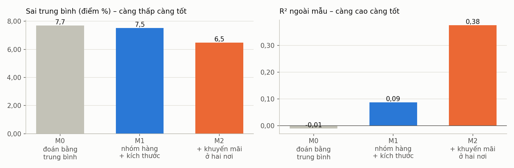
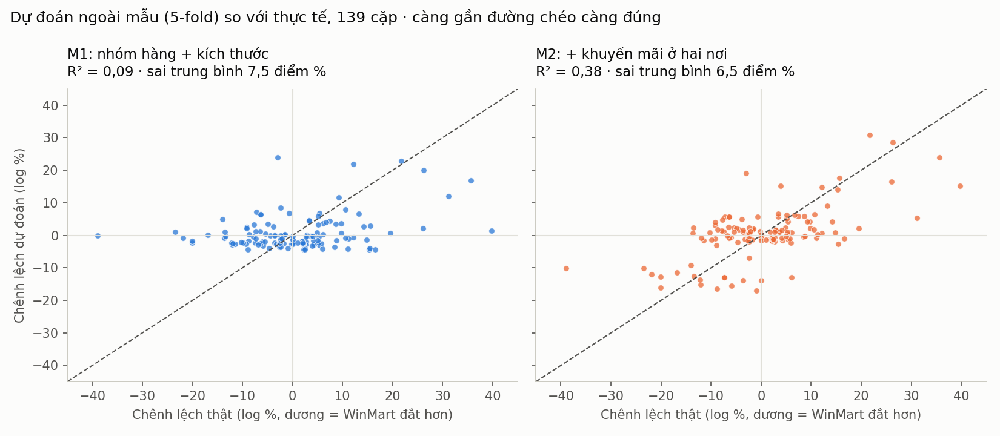

# Report 5 – Mô hình dự đoán chênh lệch giá

**Câu hỏi:** từ đặc điểm của một sản phẩm, có dự đoán được nó ở WinMart đắt hơn hay rẻ hơn Bách Hóa Xanh bao nhiêu không?

## 1. Dữ liệu và biến (slide 2.4)
- 139 cặp sản phẩm giống hệt nhau ở hai siêu thị (Report 2–3), giá lấy ngày 12/10/2026.
- **Biến cần dự đoán:** y = ln(giá WinMart / giá BHX). y > 0 là WinMart đắt hơn; e^y − 1 là phần trăm chênh lệch.
- **Biến đầu vào:** nhóm hàng (biến giả; nhóm dưới 10 cặp gộp thành "nhóm nhỏ": Tẩy rửa, Chăm sóc cá nhân), log khối lượng/dung tích, số lượng trong gói, và ở M2 thêm cờ khuyến mãi ở từng nơi (BHX 13 cặp, WinMart 24 cặp).
- **Không dùng** giá bán, giá niêm yết hay đơn giá làm biến đầu vào vì chúng chứa sẵn đáp án.

## 2. Mô hình và cách đánh giá
- **Hồi quy tuyến tính (slide 6.8)**, ước lượng bằng bình phương nhỏ nhất, tự viết bằng numpy (`report5/model.py`).
- **Mốc so sánh M0:** luôn đoán bằng chênh lệch trung bình. Mô hình chỉ có giá trị khi tốt hơn mốc này.
- **Kiểm định chéo 5 lần (seed 42):** chia 139 cặp thành 5 phần; mỗi lần học trên 4 phần, dự đoán phần còn lại. Mọi con số dưới đây là dự đoán **ngoài mẫu**. Lặp lại với 20 cách chia khác nhau để kiểm tra độ ổn định.
- **Thước đo:** R² (tỉ lệ biến động của chênh lệch được mô hình giải thích), sai trung bình tuyệt đối (điểm %), tỉ lệ đoán đúng nơi rẻ hơn (bỏ 9 cặp bằng giá).

## 3. Kết quả

| mô hình | số biến | R² (5-fold) | sai trung bình (điểm %) | đoán đúng nơi rẻ hơn (%) | R² thấp nhất (20 lần chia) | R² cao nhất (20 lần chia) |
|---|---|---|---|---|---|---|
| Mốc so sánh (đoán bằng trung bình) | 0 | -0,01 | 7,70 | — | -0,04 | -0,00 |
| Hồi quy: nhóm hàng + kích thước | 7 | 0,09 | 7,52 | 53,08 | 0,02 | 0,15 |
| Hồi quy: + khuyến mãi ở hai nơi | 9 | 0,38 | 6,47 | 56,92 | 0,35 | 0,44 |

**Đọc kết quả:**
- **M1 (chỉ đặc điểm sản phẩm)** gần như không tốt hơn mốc so sánh: R² = 0,09, sai trung bình 7,5 điểm % so với 7,7 điểm % của M0, đoán đúng nơi rẻ hơn 53%, gần như tung đồng xu. Biết loại hàng và kích thước không đoán được nơi nào rẻ hơn, khớp với kết luận kiểm định cặp (p = 0,51) ở Report 3.
- **M2 (thêm khuyến mãi)** giải thích được khoảng 38% biến động của chênh lệch (R² ngoài mẫu 0,38, dao động 0,35–0,44 qua 20 cách chia), sai trung bình giảm còn 6,5 điểm %. Chênh lệch giá gắn chủ yếu với khuyến mãi tạm thời, không phải với loại hàng.
- R² trên chính dữ liệu huấn luyện của M2 là 0,51, cao hơn R² ngoài mẫu: đây là lý do phải đánh giá ngoài mẫu.

## 4. Hệ số của M2 (học trên cả 139 cặp)

| biến | hệ số (log) | ảnh hưởng lên giá WinMart so với BHX (%) |
|---|---|---|
| Hệ số chặn (nhóm Đồ uống, không khuyến mãi) | 0,09 | 9,92 |
| nhóm Mì ăn liền | -0,07 | -6,62 |
| nhóm Sữa | -0,04 | -3,75 |
| nhóm Gia vị | -0,03 | -3,05 |
| nhóm nhỏ (Tẩy rửa + Chăm sóc cá nhân) | 0,10 | 10,12 |
| nhóm Bánh kẹo | -0,05 | -5,32 |
| log khối lượng / dung tích | -0,01 | -0,92 |
| số lượng trong gói | 0,00 | 0,26 |
| BHX đang khuyến mãi | 0,14 | 15,19 |
| WinMart đang khuyến mãi | -0,14 | -12,90 |

- Khi **WinMart đang khuyến mãi**, giá WinMart so với BHX thấp hơn khoảng 13%; khi **BHX đang khuyến mãi**, giá WinMart so với BHX cao hơn khoảng 15% (các yếu tố khác giữ nguyên).
- Hệ số cho biết mối liên hệ trong dữ liệu, không chứng minh quan hệ nhân quả.

## 5. Hạn chế
- Chỉ 139 cặp và giá lấy một lần: mô hình **giải thích** chênh lệch tại một thời điểm, chưa dự đoán được giá trong tương lai.
- Cờ khuyến mãi được ghi nhận cùng lúc với giá, nên M2 chỉ dùng được khi đã biết sản phẩm đang khuyến mãi ở đâu.
- Chưa so sánh với mô hình phi tuyến (Random Forest); với 139 cặp, mô hình phức tạp dễ học thuộc dữ liệu huấn luyện.
